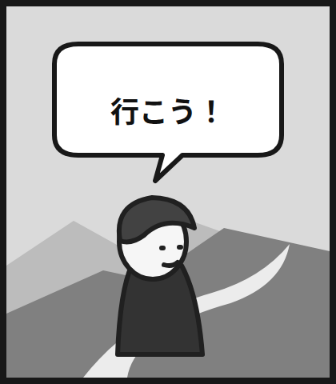
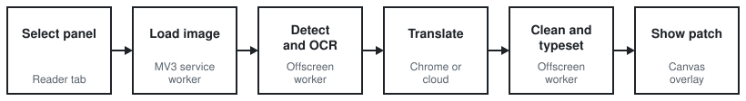

<p align="center"></p>
<h1 align="center">Manga Translator</h1>
<p align="center">Translate manga and manhwa in your Chromium browser with local OCR, text removal, and typesetting.</p>
<p align="center">
  <strong><a href="https://github.com/Yunachz/Manga-Translator/releases/latest">📦 Download release</a></strong>
  · <a href="#installation">Installation</a>
  · <a href="#how-to-use">How to use</a>
  · <a href="#architecture">Architecture</a>
</p>

## Before and after

| Original · Japanese | Translated · English |
| :---: | :---: |
| [](docs/demo/before.png) | [](docs/demo/after.png) |

<sub>Click either image to open it. This synthetic demo was captured in Chromium with local OCR and a mock translation provider.</sub>

## Features

| | What you can do |
| --- | --- |
| 🎯 **Panel selection** | Click a panel or draw a box around a specific bubble with **Select area**. |
| 📚 **Batch translation** | Translate a chapter, loaded images, or visible pages, depending on the reader. |
| 🖼️ **Local image processing** | Detect text, read it with PP-OCRv5, clean the original lettering, and fit the translation inside each bubble. |
| 🌐 **Six translation providers** | Choose Chrome Translator, Gemini, OpenAI, Google Cloud Translation, DeepL, or Azure Translator. |
| 🔄 **Compare and clear** | Switch between the original and translated views. Clear the translation when you want to start over. |
| 💬 **Language controls** | OCR supports Japanese, Korean, Chinese, and English. The interface is available in English and Indonesian. Translation language pairs depend on the provider. |

## Installation

1. Download and extract the ZIP from the [latest release](https://github.com/Yunachz/Manga-Translator/releases/latest).
2. In Chrome or another Chromium browser **116 or newer**, open `chrome://extensions` or `brave://extensions` and turn on **Developer mode**.
3. Choose **Load unpacked**, select the folder containing `manifest.json`, and pin the extension for quick access.

## How to use

### 1. Set up a translator

Open **Settings** from the popup. Choose a **Translation provider**, **Source language**, and **Target language**. For a cloud provider, enter your API key, select **Allow provider access**, save, and run **Test connection**. Chrome Translator is available on browsers that support its built-in API. Gemini and OpenAI can translate dialogue together within a panel and use an optional glossary or earlier dialogue.

> [!TIP]
> For an English scan you want to read in Indonesian, set **Source language** to **English** and **Target language** to **Indonesian**. Set **OCR language** to **English** if automatic recognition struggles. To switch the interface language, go to **Settings → Appearance**.

[Setup instructions for all six providers](docs/PROVIDERS.md)

### 2. Translate a panel

1. Open a manga page and select **Enable panel mode** in the popup.
2. Click the panel. If prompted, choose **Allow image access** in the popup and retry. If the wrong panel is detected, choose **Select area** and drag over the dialogue you want.
3. Use **Show original** and **Show translation** to compare the views. **Clear translation** removes translated patches from the active tab.

### 3. Translate multiple pages

| Reader | What the extension can process |
| --- | --- |
| Readers with a supported chapter page list | **Translate this chapter** uses the reader’s chapter page list. |
| Readers that display standard images | **Translate loaded pages** uses detected pages already loaded in the reader. |
| Supported canvas readers | **Translate visible pages** uses pages visible when you start. |

Choose **Review chapter translation** in the popup, check the page scope and language pair, then select **Start translation**. Grant image access if prompted. You can pause, stop, or retry failed pages.

> [!NOTE]
> Reader layouts affect which pages the extension can find. **Normal** is the default cleanup mode. **Constrained** tries a tighter mask, and **Conservative** also tries lower-contrast lettering. The extension may leave stylized text, sound effects, or difficult backgrounds intact.

## Architecture

[](docs/architecture.svg)

- **Content script** finds reader images, maps clicks to image coordinates, and displays the translated patch on a canvas overlay.
- **Service worker** manages permissions, the job queue, providers, and the IndexedDB cache.
- **Inference worker** runs OCR and image processing locally using ONNX Runtime Web, with WebGPU acceleration and a WASM fallback.

[Full architecture and module map](docs/ARCHITECTURE.md)

## Privacy and permissions

Manga images stay on your device. Cloud providers receive recognized text, language settings, and optional text context you enable. Cloud usage follows the pricing and quota of your own provider account.

API keys are stored for the browser session by default. **Remember API key** saves the key in the extension’s local storage, which lacks hardware-backed credential protection.

| Permission | Purpose |
| --- | --- |
| `activeTab`, `scripting` | Activate panel mode and process the reader in the selected tab. |
| `storage`, `offscreen` | Store settings and run local inference. |
| Optional host access | Read an image or contact a provider on an origin you approve. |

## Build and test

Built with **WXT, TypeScript, Svelte, and Manifest V3**. Use **Node.js 22+** to build from source.

```sh
npm ci
npm run models:setup
npm run typecheck
npm run lint
npm run build
npm test
```

Load `.output/chrome-mv3` in Chromium. Run `npm run dev` for development or `npm run zip` to create a release package.

[Model setup](docs/MODELS.md) · [Browser test guide](tests/QA-PLAN.md) · [Third-party notices](public/third-party/NOTICE.txt)
