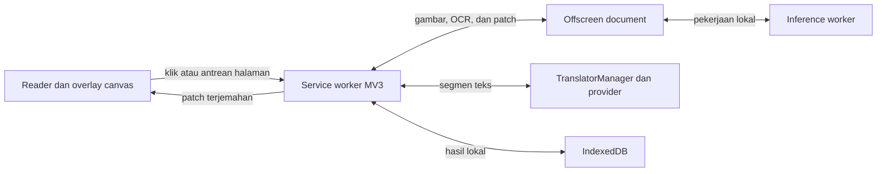

# Manga Translator


Manga Translator adalah extension Chromium untuk menerjemahkan manga dan manhwa langsung di halaman reader. Pilih panel atau beberapa halaman. Extension membaca dialog dengan OCR lokal, membersihkan tulisan asli, lalu menata hasil terjemahan pada gambar. Tombol **Show original** mengembalikan tampilan asli seketika.

[Unduh ZIP v1.0.0](https://github.com/Yunachz/Manga-Translator/releases/tag/v1.0.0) · [Arsitektur lengkap](docs/ARCHITECTURE.md) · [Panduan provider](docs/PROVIDERS.md)

## Sebelum dan sesudah

| Dialog asli | Hasil di reader |
| --- | --- |
|  |  |

Demo direkam dari extension yang berjalan di Chromium. OCR menggunakan model lokal. Terjemahan demo memakai respons uji agar contoh dapat diulang tanpa API key.

## Fitur

- **Klik panel dan pilih area.** Extension mendeteksi panel dari titik yang diklik. Gunakan **Select area** untuk memilih satu dialog atau panel secara manual.
- **Terjemahan beberapa halaman.** Proses satu bab pada adapter dengan daftar halaman lengkap, halaman yang sudah termuat pada reader gambar generik, atau halaman yang terlihat pada reader canvas yang kompatibel. Antrean dapat dijeda, dihentikan, dan dicoba ulang untuk halaman yang gagal.
- **OCR dan pembersihan lokal.** PP‑OCRv5 mendukung Jepang, Korea, Mandarin, dan Inggris. ONNX Runtime Web memakai WebGPU bila tersedia dan bisa kembali ke WASM. Inpainting menghapus glyph asli sebelum hasil ditata di area dialog.
- **Enam provider terjemahan.** Gemini, OpenAI, Chrome Translator, Google Cloud Translation, DeepL, dan Azure Translator. Provider cloud memakai API key pengguna. Gemini dan OpenAI dapat menerjemahkan dialog satu panel dengan konteks bersama.
- **Kontrol hasil.** **Show original** menyembunyikan terjemahan, **Show translation** menampilkannya lagi, dan **Clear translation** menghapus hasil di tab aktif.
- **Antarmuka Inggris dan Indonesia.** Bahasa antarmuka awal adalah Inggris. Bahasa OCR, sumber, dan tujuan terjemahan diatur terpisah.

## Instalasi

1. Gunakan Chrome atau browser berbasis Chromium versi 116 ke atas. Unduh `manga-translator-1.0.0-chrome.zip` dari halaman rilis dan ekstrak.
2. Buka halaman pengelolaan extension, misalnya `chrome://extensions` di Chrome atau `brave://extensions` di Brave. Aktifkan **Developer mode**.
3. Klik **Load unpacked** dan pilih folder hasil ekstrak yang berisi `manifest.json`.
4. Sematkan **Manga Translator** di toolbar agar popup mudah dibuka.

## Cara penggunaan

### Atur bahasa dan provider

1. Buka popup dan pilih **Settings**. Pilih provider, **Source language**, dan **Target language**. Untuk scan berbahasa Inggris yang ingin diterjemahkan ke Indonesia, pilih **English → Indonesian**. Jika OCR otomatis kurang akurat, set **OCR language** ke **English**.
2. Untuk provider cloud, masukkan API key dari akun Anda, pilih **Allow provider access**, simpan, dan jalankan **Test connection**. Chrome Translator memakai API bawaan browser bila mendukung pasangan bahasa yang dipilih. [Cara menyiapkan tiap provider](docs/PROVIDERS.md)
3. Untuk mengubah bahasa antarmuka, buka **Settings → Appearance → Interface language**.

### Terjemahkan satu panel

1. Buka reader. Klik **Enable panel mode** dari popup, lalu klik panel.
2. Jika muncul permintaan izin gambar, buka popup dan pilih **Allow image access**, lalu coba lagi. Izin diberikan untuk origin sumber gambar yang dibutuhkan.
3. Bila panel otomatis tidak sesuai, pilih **Select area** dan seret di atas dialog atau panel. Tombol ini tetap tersedia setelah panel selesai diterjemahkan.
4. Pilih **Show original** untuk membandingkan hasil. Gunakan **Clear translation** di popup untuk menghapus hasil pada reader di tab itu.

**Inpainting mode** dapat dipilih dari popup. **Normal** adalah bawaan. **Constrained** mencoba mask yang lebih sempit pada tulisan sulit. **Conservative** juga mencoba tulisan dengan kontras lebih rendah. Jika suatu bagian sulit dibersihkan, extension dapat mempertahankan tulisan asli di bagian itu dan menerjemahkan bagian lain.

### Terjemahkan beberapa halaman

| Jenis reader | Aksi di popup | Cakupan |
| --- | --- | --- |
| MangaDex dan Silent Witch | **Translate this chapter** | Daftar halaman bab yang dikenali adapter |
| Reader gambar generik, misalnya MangaKatana | **Translate loaded pages** | Gambar halaman yang sudah termuat dan dikenali. Gulir untuk memuat halaman berikutnya |
| Comic Action dan reader canvas dengan struktur serupa | **Translate visible pages** | Halaman yang terlihat saat aksi dimulai |

1. Buka menu terjemahan bab dari popup, periksa provider dan pasangan bahasa, lalu mulai.
2. Setujui **Allow image access** jika diperlukan. MangaDex dapat meminta izin terpisah untuk API daftar halaman dan domain CDN gambar.
3. Gunakan **Pause** untuk menjeda setelah halaman aktif selesai, **Stop chapter** untuk menghentikan antrean, atau **Retry failed pages** untuk mencoba ulang halaman yang gagal. Pemrosesan dapat berjalan saat popup ditutup.

## Arsitektur



- **Content script** memilih sumber halaman, memetakan koordinat klik dan pilihan manual, serta menampilkan patch pada canvas overlay. Reader tetap menggunakan gambar sumbernya.
- **Service worker** memvalidasi pesan, menangani izin dan kredensial, mengatur antrean dan cache, serta mengirim dialog ke provider yang dipilih.
- **Offscreen document dan inference worker** menjalankan deteksi panel, pemotongan gambar, OCR, urutan baca, mask, inpainting, dan typesetting. Offscreen document juga menjadi host Chrome Translator.
- **Provider dan cache** dipisahkan dari pemrosesan gambar. Segmen terjemahan mempertahankan ID dialog agar teks masuk kembali ke bubble yang tepat. Cache memakai hash gambar dan konfigurasi yang relevan.

Source memakai **WXT, TypeScript, Svelte, dan Manifest V3**. Titik masuk ada di `src/entrypoints/`. Modul pipeline, deteksi, OCR, provider, dan render ada di `src/core/`. Kontrak data dan pesan ada di `src/types/` dan `src/messaging/`. [Arsitektur dan kontrak](docs/ARCHITECTURE.md)

## Privasi dan izin

Piksel manga diproses di perangkat. Provider cloud menerima teks OCR dan pengaturan bahasa. Gemini dan OpenAI juga menerima konteks teks seperti judul seri, glosarium, atau dialog sebelumnya jika diaktifkan. Biaya dan kuota terjemahan mengikuti akun pengguna pada provider.

API key berasal dari pengguna dan disimpan di `chrome.storage.session` secara default. **Remember API key** menyimpannya di penyimpanan lokal extension, yang tidak memiliki perlindungan vault perangkat keras. Halaman reader dan content script tidak menerima key. Cache OCR, terjemahan, dan patch disimpan lokal di IndexedDB.

| Izin | Penggunaan |
| --- | --- |
| `activeTab` | Akses sementara untuk tab aktif dan tangkapan area terlihat atas tindakan pengguna |
| `scripting` | Memasang content script pada tab yang diaktifkan |
| `storage` | Menyimpan pengaturan, status mode, dan kredensial |
| `offscreen` | Menjalankan inference worker dan Chrome Translator |
| Host opsional | Akses origin API provider atau sumber gambar setelah pengguna mengizinkan |

## Batasan

- Cakupan mode bab bergantung pada cara reader memuat halaman. Saat tata letak atau sumber gambar tidak dikenali, gunakan **Select area** pada bagian yang terlihat.
- Ketelitian OCR bervariasi pada furigana, teks vertikal atau miring, font dekoratif, dan SFX. Pada beberapa tulisan, OCR dapat kehilangan spasi atau salah membaca tanda baca.
- Inpainting bisa menghaluskan screentone atau tekstur tepat di bawah glyph. Area yang belum bisa dibersihkan secara memadai dapat tetap menampilkan teks asli.
- Ketersediaan Chrome Translator bergantung pada browser dan pasangan bahasa. Uji provider cloud langsung memerlukan akun dan kuota pengguna.

## Pengembangan dan pengujian

Gunakan Node.js 22 atau lebih baru dan npm. Node.js dipakai untuk pengembangan dan proses build. Extension terpasang berjalan di Chromium.

```sh
npm ci
npm run models:setup
npm run typecheck
npm run lint
npm run build
npm test
npm run verify:build
npm run zip
```

Build unpacked ada di `.output/chrome-mv3`. ZIP instalasi ada di `.output/manga-translator-1.0.0-chrome.zip`. Gunakan `npm run dev` untuk pengembangan WXT. Aset model yang dipin dengan checksum disertakan di build agar OCR dapat berjalan offline. [Panduan model dan aset opsional](docs/MODELS.md)

Untuk uji browser, buat build terlebih dahulu:

```sh
npx playwright install chromium
npm run test:e2e
```

Tes menggunakan gambar sintetis untuk menguji reader dan pipeline, OCR lokal, serta provider tiruan untuk memverifikasi alur tanpa kuota API. [Panduan QA](tests/QA-PLAN.md) · [Pemberitahuan pihak ketiga](public/third-party/NOTICE.txt)
