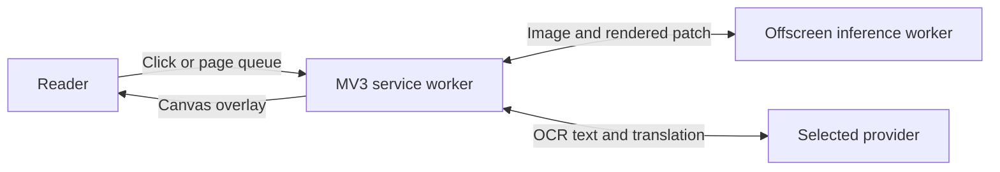

<p align="center"></p>
<h1 align="center">Manga Translator</h1>
<p align="center">Read manga and manhwa in your language, right on the page.</p>
<p align="center">
  <strong><a href="https://github.com/Yunachz/Manga-Translator/releases/latest">Download for Chromium</a></strong>
  · <a href="#quick-start">Quick start</a>
  · <a href="#under-the-hood">Under the hood</a>
</p>

## Before and after

| Original · Japanese | Translated · English |
| :---: | :---: |
| [](docs/demo/before.png) | [](docs/demo/after.png) |

<sub>Demo captured in Chromium with local OCR and a mock translation provider.</sub>

## Quick start

1. **Install.** Extract the release ZIP. In Chromium 116 or newer, open `chrome://extensions` (or `brave://extensions`), turn on **Developer mode**, and choose **Load unpacked**. Select the folder containing `manifest.json`.
2. **Configure.** Open **Settings** and choose your languages and provider. Chrome Translator works on supported browsers. For cloud providers, add your API key, grant access, save, and run **Test connection**. [Six supported providers](docs/PROVIDERS.md)
3. **Read.** On a manga page, enable panel mode and click a panel. If needed, grant **Allow image access** or drag a box with **Select area**. Toggle **Show original** to compare.

<details>
<summary><strong>Translate multiple pages</strong></summary>

| Reader | Popup action |
| --- | --- |
| MangaDex or Silent Witch | **Translate this chapter** |
| Standard image readers, such as MangaKatana | **Translate loaded pages** |
| Comic Action and compatible canvas readers | **Translate visible pages** |

The page queue supports pause, stop, and retry. **Clear translation** removes results from the active tab.

</details>

## Under the hood

**On-device OCR, text removal, and typesetting.** PP‑OCRv5 reads Japanese, Korean, Chinese, and English. ONNX Runtime Web uses WebGPU when available, with a WASM fallback. The extension draws the translated patch over the reader.

<details>
<summary><strong>Architecture and privacy</strong></summary>



The service worker handles permissions, provider requests, and the local cache. The inference worker handles image processing and may leave stylized text or sound effects intact when cleanup is uncertain. Cloud providers receive OCR text and enabled text context. Image pixels stay on the device. API keys use session storage by default. Cloud usage follows your provider’s pricing and quota.

[Full architecture](docs/ARCHITECTURE.md) · [Providers and permissions](docs/PROVIDERS.md)

</details>

<details>
<summary><strong>Build and test</strong></summary>

Requires Node.js 22+. Built with WXT, TypeScript, Svelte, and Manifest V3.

```sh
npm ci
npm run models:setup
npm run build
npm test
```

Load `.output/chrome-mv3` to test locally. Run `npm run zip` to package it.

[Model setup](docs/MODELS.md) · [Browser test guide](tests/QA-PLAN.md) · [Third-party notices](public/third-party/NOTICE.txt)

</details>
